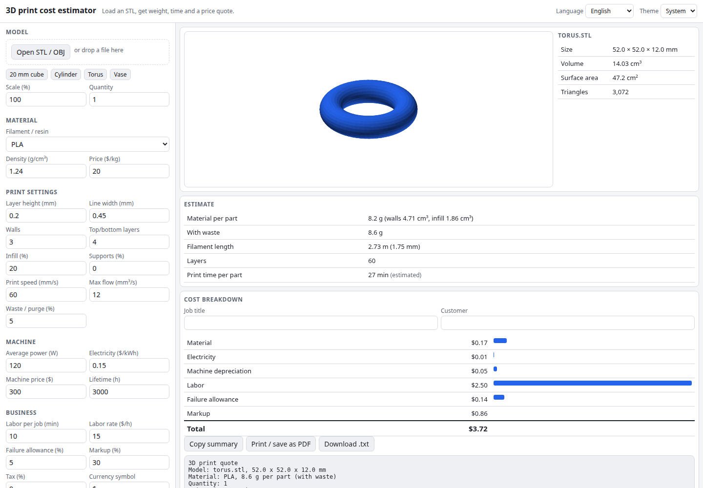

# 3D Print Cost Estimator

What will this 3D print cost? Load an STL (or OBJ), pick a filament or resin, and get the model's volume and surface area, the material weight and filament length, an estimated print time and a full price quote: material, electricity, machine depreciation, labor, failure allowance, markup and tax. Optionally load the sliced G-code to use the slicer's own time and filament numbers. Everything runs in your browser.

**Try it: [hermes98761234.github.io/print-cost-estimator](https://hermes98761234.github.io/print-cost-estimator/)**

[](https://github.com/hermes98761234/print-cost-estimator/actions/workflows/deploy.yml)



## Features

- **STL (binary and ASCII) and OBJ**, with a drag-to-rotate preview, bounding box, volume, surface area and triangle count. Warns about open (non-watertight) meshes and inverted normals. Built-in samples load instantly.
- **Material presets**: PLA, PETG, ABS, ASA, TPU, Nylon and standard resin, each with an editable density and price per kg.
- **Material from walls and infill**: wall count and line width, top/bottom layers, infill percentage, supports and waste/purge percentages. Resin supports solid or hollowed models.
- **Time estimate** from a volumetric flow limit, layer overhead and warm-up, or from **G-code**: the slicer's own estimate (Cura, PrusaSlicer/SuperSlicer, OrcaSlicer/Bambu Studio, Simplify3D comments) and filament use, or a move-by-move simulation with acceleration when there is no comment.
- **Quote**: material, electricity (average power), machine depreciation (price over lifetime), labor, failure allowance, markup, tax, quantity and per-unit price. Copy it as text, download a `.txt`, or print / save as PDF.
- **Scale** the model in percent; **English and Ukrainian**, light/dark/system theme, any currency symbol. Settings are remembered in the browser.
- **No backend, no tracking.** Your files never leave the browser.

## How it works

Volume is the signed sum of tetrahedra over the triangles, area the sum of triangle areas, and open edges are found by counting how many triangles use each edge.

For FDM, the shell is the area-weighted wall volume: each triangle contributes its area times the wall thickness (`walls x line width`) for vertical faces and times the top/bottom thickness (`layers x layer height`) for horizontal ones, blended by the normal's Z component and capped at the model volume. The infill is the remaining interior volume times the infill percentage. Time is deposited volume divided by `min(speed x line width x layer height, max flow)`, plus 2.5 s per layer and 5 minutes of warm-up. These are estimates: slicers differ by 10-30%, so load the G-code when you have it.

Cost is `(material + electricity + depreciation + labor) x (1 + failure)`, then markup, then tax.

## Quick start

You need [Node.js](https://nodejs.org/) 22.

```bash
git clone https://github.com/hermes98761234/print-cost-estimator.git
cd print-cost-estimator
npm install
npm run dev       # http://localhost:5173
npm test          # mesh, G-code, estimate and i18n tests
npm run build     # static site in dist/
```

## License

MIT
